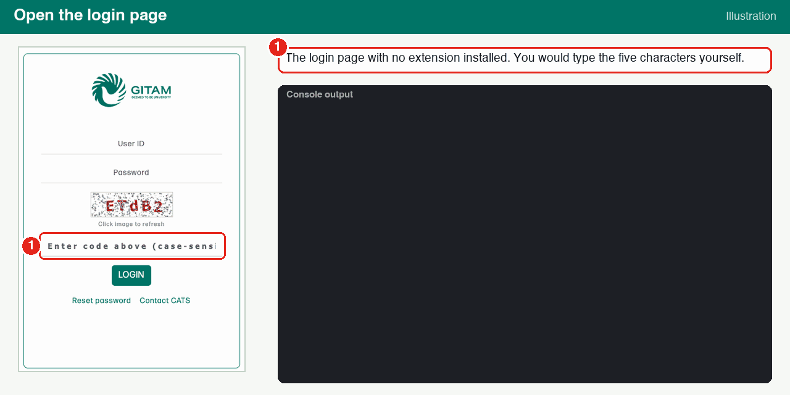
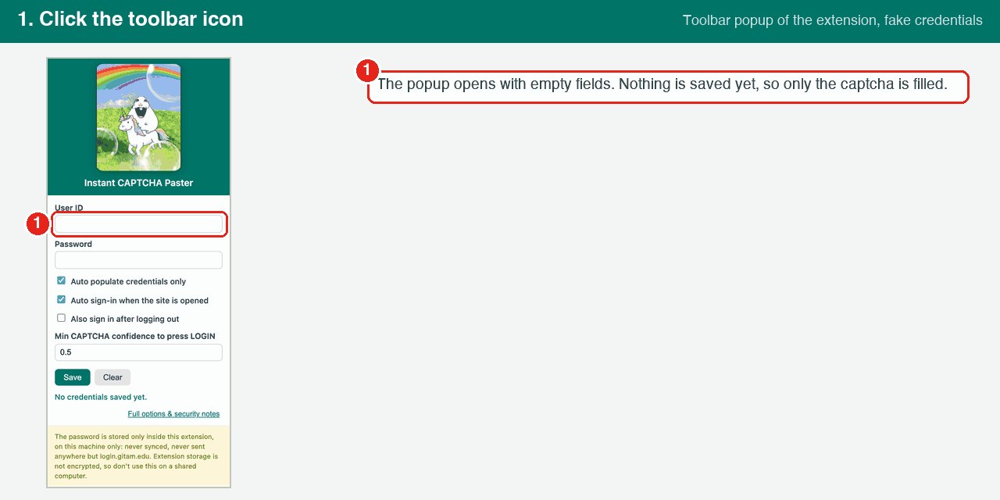
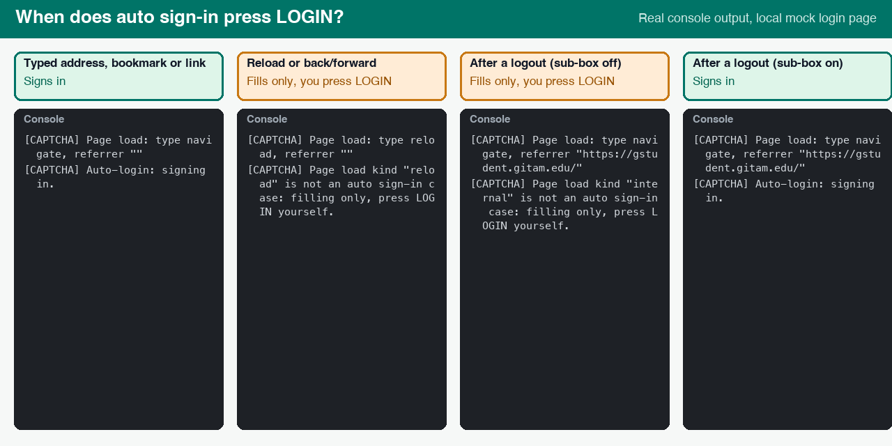

# Instant CAPTCHA Paster

A Chrome extension that reads the 5-character captcha on `login.gitam.edu` and types it into the box for you. The reading is done by a small neural network that runs inside the extension, so there is no server, no API and nothing to install besides the extension itself. If you want, it also fills in your User ID and password and presses LOGIN.



The pictures in this README are illustrations of what you should expect to see, not captures of a live sign-in.

This repo also has everything I used to train the model: data tools, notebooks, and the script that exports the network to the browser. See [Development](#development).

## Install

You need Chrome, Edge or Brave. No Python, no helper program.

1. Grab `captcha-paster-5.5.zip` from the [latest release](https://github.com/VarunMatta5625/captcha_tester/releases/latest) (about 7 MB), or clone the repo and use the `extension/` folder as is.
2. Unzip it somewhere it can stay. The browser keeps loading the extension from that folder, so don't put it in Downloads and forget about it.
3. Go to `chrome://extensions` (`edge://extensions`, `brave://extensions`) and switch on **Developer mode**, top right.
4. Click **Load unpacked** and pick the `captcha-paster` folder, the one with `manifest.json` in it.


Pinning the extension (puzzle-piece icon in the toolbar) makes the settings one click away.

To update, replace the files in that folder and hit the circular arrow on the extension's card. To remove it, use **Remove** on the card; that also deletes the saved password.

## Using it

Open `login.gitam.edu`. The captcha box fills itself, and fills again each time the captcha refreshes.


To check it's working, open the browser console (right-click, Inspect, Console). Every captcha logs a line like this:

```text
[CAPTCHA] Pasted J2qgj (confidence 0.892, model 108 ms, total 214 ms)
```

Confidence under roughly 0.5 means it's guessing. Look at the box before you submit.


### Filling in your login

Click the toolbar icon, enter your User ID and password, tick what you want, and Save.



- **Auto populate credentials only**: fills User ID, password and captcha. You press LOGIN.
- **Auto sign-in when the site is opened**: also presses LOGIN, once. Ticking it ticks the box above.
- **Also sign in after logging out**: off by default, only available when auto sign-in is on. Lets it sign in when you land on the login page from another `gitam.edu` page (after a logout or a session timeout).
- **Min CAPTCHA confidence to press LOGIN**: 0.5 by default. Below it, the captcha is still filled but you press LOGIN yourself. `0` means always press.

On a fresh install the first two boxes are ticked, but nothing happens until you've saved a User ID and password.

With only the first box ticked, you press the last button:


With auto sign-in on, opening the page is all it takes. This console output is from a test against a local copy of the form, since a real sign-in needs a real account:


### When it presses LOGIN

Pressing LOGIN is the part that can go wrong. I assume the site locks a User ID after 5 failed logins (more on that under [Known limits](#known-limits)), so the extension is careful:

| How the page was opened | Signs in? |
|---|---|
| Typed address, bookmark, link from another site | Yes, if auto sign-in is on |
| Arrived from another `gitam.edu` page (logout, timeout) | Only with "Also sign in after logging out" |
| Reload, back/forward, restored tab | Never |
| Site said "Invalid CAPTCHA" after a press | Retries once (at most 2 presses per tab) |

It also stays out of it when the page shows any other message (wrong password, locked account), when there's a rate-limit break on screen, when Google reCAPTCHA is showing, when you've changed the captcha box yourself, or when the confidence is under your minimum. In all of those the form is still filled and the last click is yours.



### Captchas the site rejects

If the model's read goes in unchanged and the reloaded page says "Invalid CAPTCHA", the extension saves the image to `Downloads/captcha_mistakes/<time>_model-<read>_conf-<confidence>.png` (time in UTC). The file name only tells you what the model thought it saw. The right answer isn't known. A wrong password, a successful login, or a code you retyped yourself saves nothing.

These files are what I use for the next training round. Extensions can only write under Downloads, which is why they end up there.


The page in that picture is a local copy that rejects everything on purpose, to show the retry limit.

## How it works

The captcha is a 150x45 image. The extension cleans it up, runs it through a 1.8-million-weight convolutional network compiled to WebAssembly, and types the result. The longer version is in [docs/HOW_IT_WORKS.md](docs/HOW_IT_WORKS.md).

The short version of the files:

- `content.js` runs on the login page. It grabs the captcha pixels, asks the background worker to read them, types the answer, and handles the auto sign-in logic.
- `background.js` is the service worker. It loads the model, reads captchas, and saves rejected ones.
- `model.js`, `model.wasm` and `model/` are the cleaning step, the compiled math kernels and the trained weights.
- `popup.html`, `options.html` and `settings-ui.js` are the settings.

The model is called v5. It scores 200/200 on a set of 200 captchas I checked by hand and never trained on, and it reads all 8 captchas the site rejected from an earlier version correctly. The site has changed its captcha style twice, so see [docs/CHANGELOG.md](docs/CHANGELOG.md) for how the models got here.

## Privacy and security

- The extension makes no network requests of its own. The only `fetch` calls load its own model files.
- Permissions are `storage` and `downloads`. The content script only runs on `login.gitam.edu`.
- Your User ID and password are kept in `chrome.storage.local`, on your machine only, never synced. **They are not encrypted.** Don't use auto sign-in on a shared computer. "Clear" in the popup deletes them, and removing the extension does too.
- Nothing about any login is in this repo. The settings form starts empty.

One thing to know about auto sign-in: the attempt counters are per tab and start over whenever you open the login page without a message on it. If the saved password is wrong, every fresh open of the page signs in once more and costs one failed login. Fix the password or untick auto sign-in after the first failure.

This is for signing in to your own account. Whether that's okay under the site's terms is up to you.

## Known limits

- **Release 5.5 presses LOGIN on an empty form** if auto sign-in is on and no credentials are saved yet. That's fixed in the source (see the "Unreleased" part of the [changelog](docs/CHANGELOG.md)) but not in a published zip. Until there's a new one, save your login first or untick both boxes.
- **A new captcha style breaks it.** The model reads the current style. If the site changes it again, accuracy drops until I train a new one ([docs/TRAINING.md](docs/TRAINING.md#new-captcha-style)).
- **Confident misses happen.** v5 has still had captchas rejected that it read with confidence 0.90 to 0.93, so the confidence setting can't catch them. Each costs a login attempt. The weakest pair is 8 read as B.
- **The page is hard-coded.** It looks for the element ids `imgCaptcha`, `txtCaptchaInput`, `txtusername`, `password`, `Submit` and `lblmessage`. If the site renames them, the console says `Captcha elements not found`.
- **No reCAPTCHA.** If the site shows Google's reCAPTCHA instead of the image, auto sign-in does nothing.
- **The 5-attempt lockout is an assumption** from how the site behaved for me. I haven't verified it.
- **Testing was limited.** The model was checked against the 200 hand-checked captchas and 8 real rejections, in Node against PyTorch. The extension itself (filling, auto sign-in, the rules, saving rejected captchas) was tested in Chromium 145 against a local copy of the login form. Signing in, the rules and the saving of rejected captchas haven't been tested against the live site. Windows, Linux, Edge and Brave haven't been tried either.
- **Chromium only.** There's no Firefox build. A Safari port exists for the old captchas, in `archive/`.

## Development

```sh
pip install -r requirements.txt
python3 tools/check_extension.py
```

The check runs the model through the extension's own `model.js` and `model.wasm` in Node, and through PyTorch, and fails unless all 208 reads match. It needs `node` and `data/captchas.zip`, which isn't in the repo (it's about 800 MB).

What's where:

- `extension/`: the extension
- `models/`: `captcha_cnn_v5.pt` (shipped) and `captcha_cnn_v4_ft.pt` (the model that labelled v5's training data)
- `notebooks/`, `scripts/`, `tools/`: the training round, data tools, the pre-ship check, and the scripts that make the pictures
- `data/`: the hand-checked set, my reviews, labels, and the 8 rejected captchas
- `archive/`: older work, kept as it was

Shipping a model, making a release and rebuilding the pictures are covered in [docs/DEVELOPMENT.md](docs/DEVELOPMENT.md). Training is in [docs/TRAINING.md](docs/TRAINING.md).
