<div align="center">

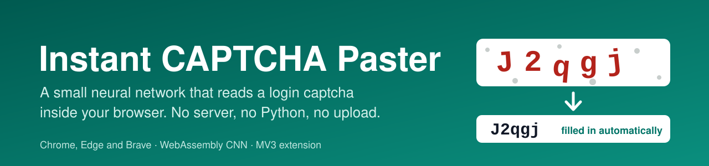

<br>


**A Chrome extension that reads the 5-character login captcha on `login.gitam.edu` with a small CNN running inside the browser (WebAssembly), and can fill your login and sign you in.**

[Setup](#setup) · [Overview](#overview) · [Usage](#usage) · [How it works](#how-it-works) · [Security](#security) · [Known limits](#known-limits) · [Development](#development) · [Docs](#documentation-map)

<br>


</div>

> [!NOTE]
> **The login screenshots are of the real login page**, opened read-only in a throwaway browser profile (never my own browser): the page is loaded and the extension fills it, and **nothing is ever submitted**. Any User ID or password in a picture is a fake one. The two exceptions are labelled in place: pictures of *signing in* and of *rejected captchas* show console output from a test run on a local stand-in page, because those need a real account or a real rejection on the real site. The folder picker in the install step is an illustration, because it is an operating system window.

---

## Setup

From download to a login page that fills itself: install, first run, first use. About five minutes.

### 1. Install

You need Chrome, Edge or Brave. Nothing else: no Python, no helper program.

1. Download `captcha-paster-5.5.zip` from the [latest release](https://github.com/VarunMatta5625/captcha_tester/releases/latest) (about 7 MB; while the repository is private you must be signed in with access to it). Or clone this repository and use its `extension/` folder directly.
2. Unzip it somewhere **permanent**: the browser keeps loading the extension from that folder. You get one folder, `captcha-paster`.
3. Open `chrome://extensions` (Edge: `edge://extensions`, Brave: `brave://extensions`) and turn on **Developer mode**, top right.
4. Click **Load unpacked** and choose the `captcha-paster` folder (the one that contains `manifest.json`).

<p align="center">
  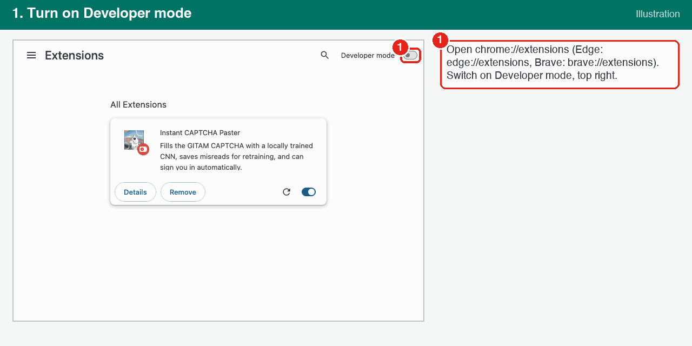
</p>

<details>
<summary><b>The three steps as still pictures, and the folder picker</b></summary>

<p align="center">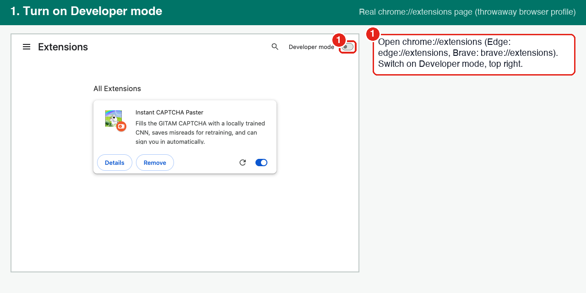</p>
<p align="center">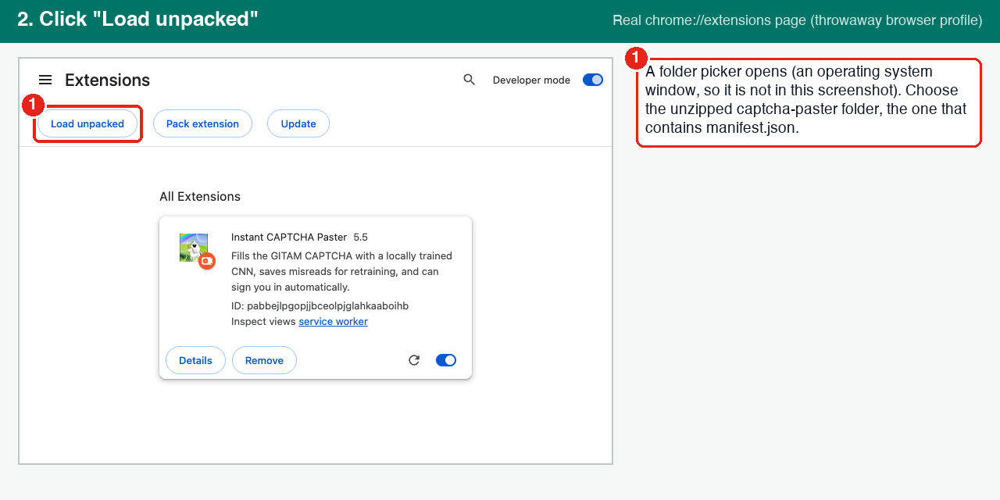</p>
<p align="center">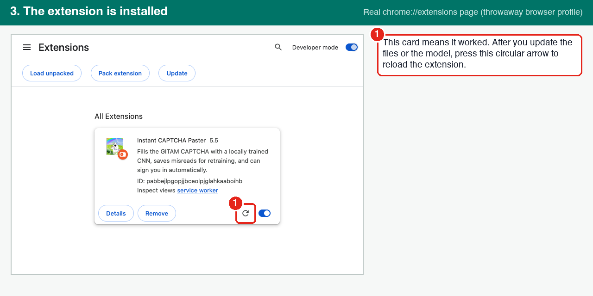</p>

The folder picker is an operating system window and cannot be captured from the page, so this is an **illustration**:

<p align="center">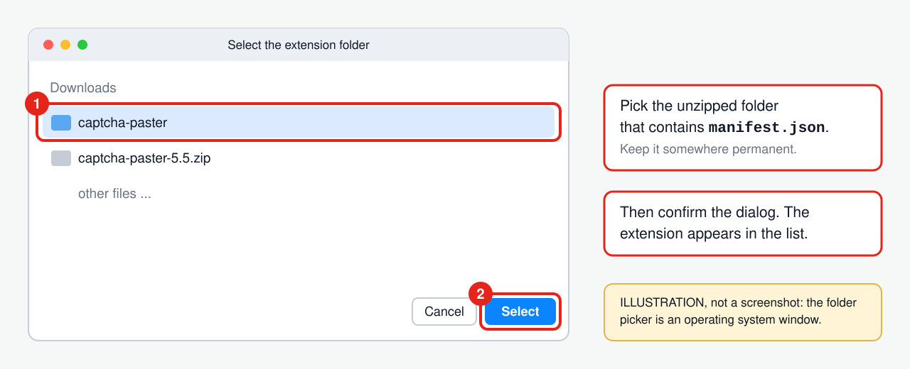</p>

In these pictures the extension was loaded with a launch flag in a throwaway browser profile instead of the picker; the card is what you will see afterwards.

</details>

> [!TIP]
> Pin the extension (puzzle-piece icon in the toolbar) to reach its settings in one click.

### 2. First run

Open `login.gitam.edu`. The captcha box fills itself, and again every time the captcha refreshes.

<p align="center">
  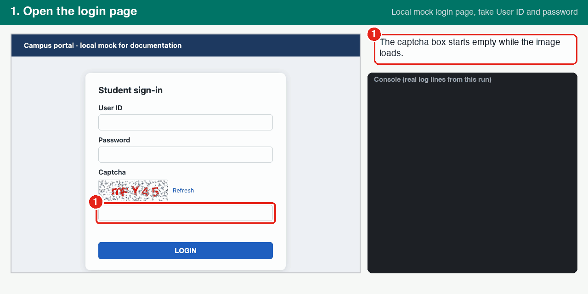
</p>

<details>
<summary><b>Still picture of the empty state</b></summary>

<p align="center">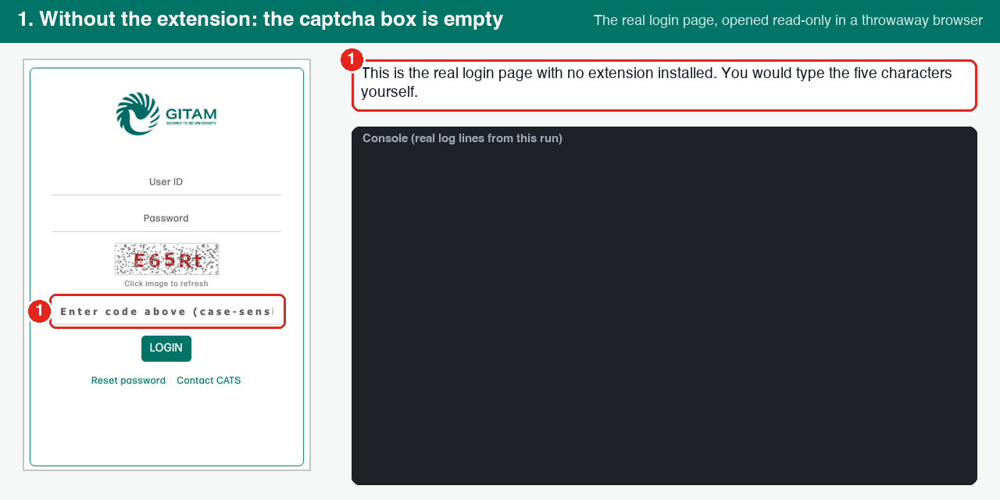</p>

</details>

To see that it works, right-click the page, choose **Inspect**, then **Console**. Each captcha logs one line:

```text
[CAPTCHA] Pasted J2qgj (confidence 0.892, model 108 ms, total 214 ms)
```

A confidence below about 0.5 means the read is a guess: check the box before you submit.

<p align="center">
  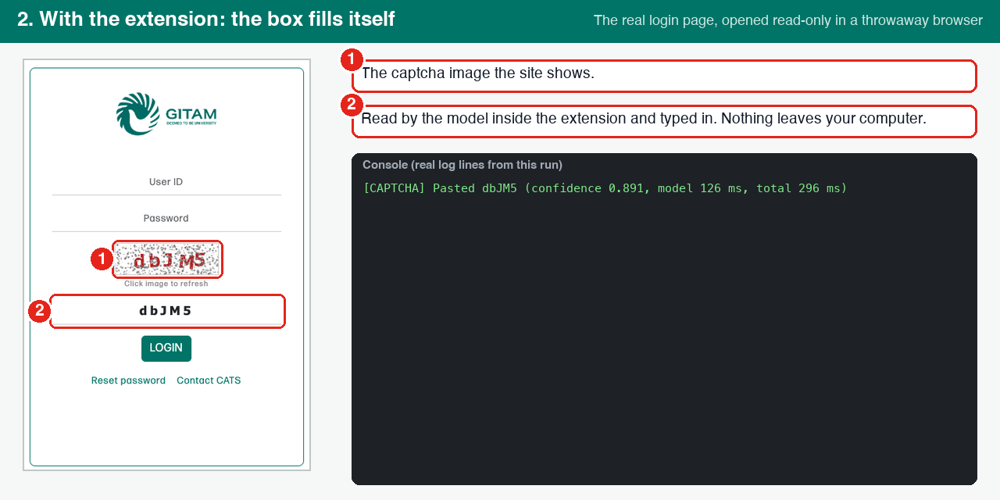
</p>

### 3. First use: let it sign in for you (optional)

Click the toolbar icon, type your User ID and password, choose how far it should go, and **Save**.

<p align="center">
  
</p>

| Box | What it does |
|---|---|
| **Auto populate credentials only** | Fills User ID, password and captcha. You press LOGIN. |
| **Auto sign-in when the site is opened** | Also presses LOGIN, once, when you open the login page by typed address, bookmark or link. Ticking it ticks the box above. |
| **Also sign in after logging out** | Sub-box of auto sign-in, off by default. Also signs in when you arrive from a `gitam.edu` page (logout, session timeout). |
| **Min CAPTCHA confidence to press LOGIN** | Default 0.5. Below it, the captcha is still filled and LOGIN is left to you. `0` means always press. |

On a fresh install the first two boxes are ticked. A save of a User ID and password is what switches things on. (Release 5.5 has one bug here: with auto sign-in on and nothing saved yet, it presses LOGIN on the empty form. This is fixed in the source but not yet released, see [Known limits](#known-limits).)

<details>
<summary><b>The popup, step by step (still pictures)</b></summary>

<p align="center"></p>
<p align="center">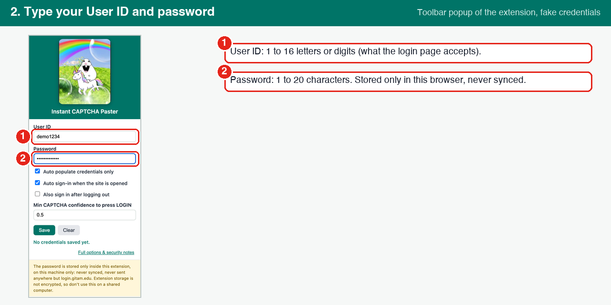</p>
<p align="center">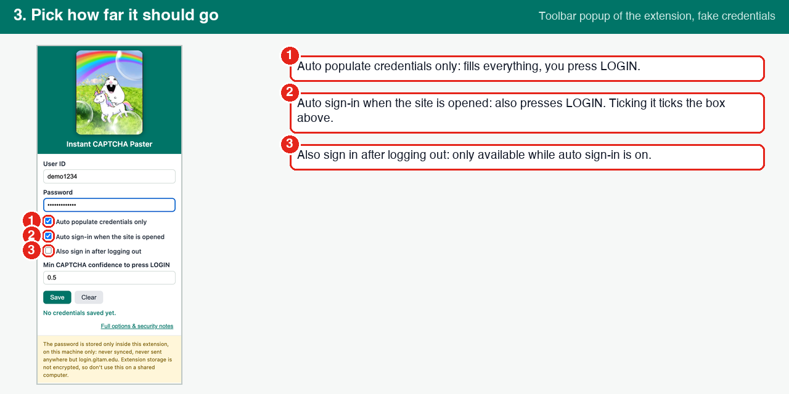</p>
<p align="center">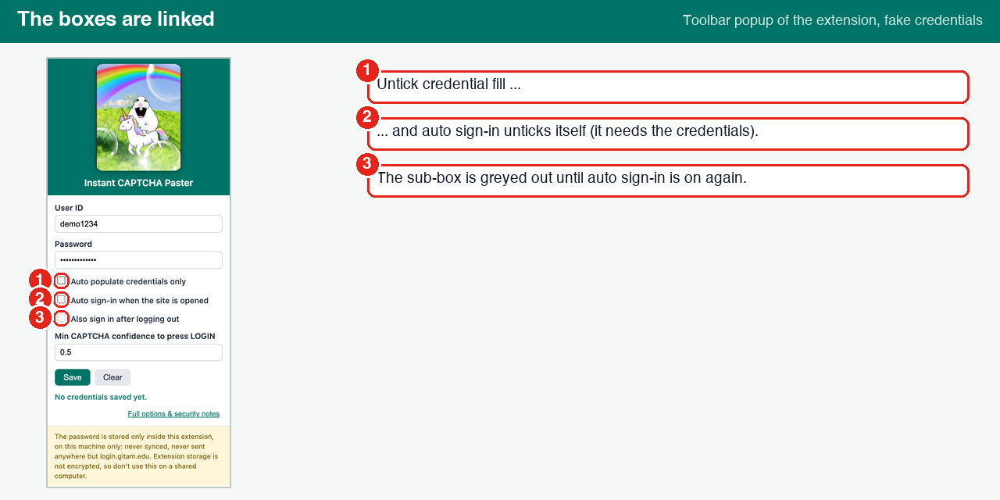</p>
<p align="center">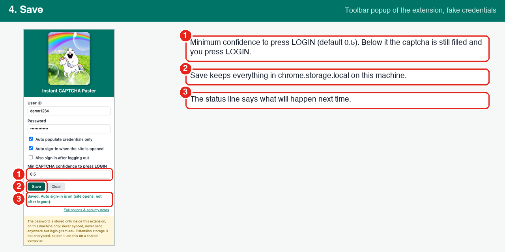</p>

</details>

With only the first box ticked you get this, and the last click is yours:

<p align="center">
  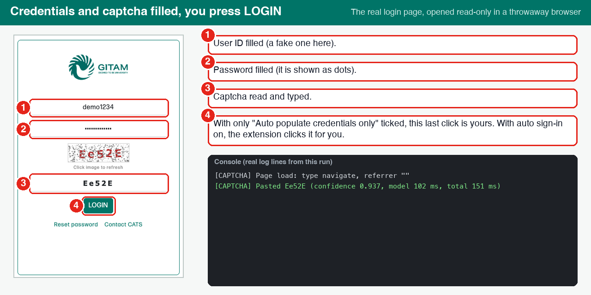
</p>

With auto sign-in on, opening the page is enough: the extension reads the captcha, fills the form and presses LOGIN by itself. Signing in needs a real account, so this is shown as console output from a test run on a local stand-in page (not the real site):

<p align="center">
  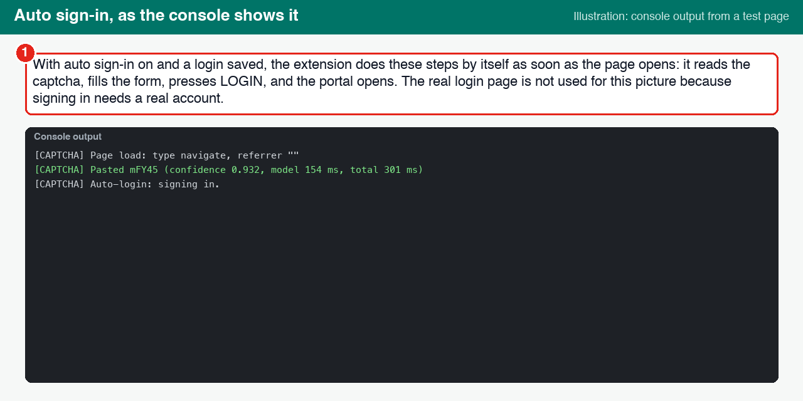
</p>

> [!IMPORTANT]
> The password is stored **unencrypted** in the extension's local storage on this machine (never synced). Do not use auto sign-in on a shared computer. Details in [Security](#security).

<details>
<summary><b>Update, remove, build the zip yourself</b></summary>

- **Update:** replace the contents of the folder with the new release, then press the circular arrow on the extension's card in `chrome://extensions`.
- **Remove:** `chrome://extensions`, **Remove**. This also deletes the saved password. **Clear** in the popup removes only the credentials.
- **Build the zip yourself:** `./build_zip.sh` writes `dist/captcha-paster-<version>.zip` ([DEVELOPMENT.md](docs/DEVELOPMENT.md)).

</details>

---

## Overview

The login page shows a 150x45 captcha of five characters. The extension takes that image, cleans it, and feeds it to a 1.8-million-weight convolutional network that runs in WebAssembly **inside the extension itself**. The answer is typed into the captcha box in a fraction of a second.

- **Nothing leaves your computer.** No server, no API, no Python, no native helper. The extension makes no network requests of its own.
- **Works in any Chromium browser** (Chrome, Edge, Brave). The screenshots were made with Chromium 145; Windows and Linux are untested here (the code has nothing platform-specific).
- **Optional auto-login** with safety guards that keep it from burning login attempts ([Usage](#usage)).
- **Learns from its mistakes.** A captcha the site rejects is saved as a PNG for the next training round.
- **A reproducible training workspace** is in this repository: data tools, notebooks, the export script and a check that the browser output equals the PyTorch output ([Development](#development)).

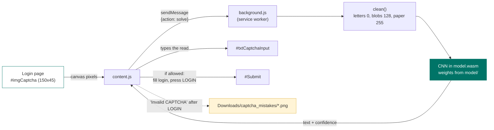

| Model | Style it was trained for | Hand-checked gold | Site rejections |
|---|---|---|---|
| **v5** (extensions 5.3 to 5.5) | style 3, the current captcha | **200/200** | **8/8** |

<p align="center">
  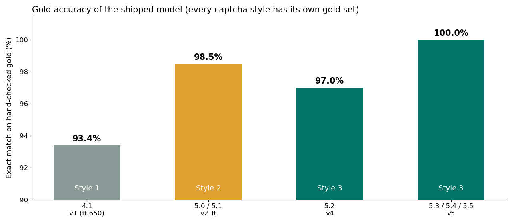
</p>

---

## Usage

### Every refresh is read

<p align="center">
  
</p>

<details>
<summary><b>The four captchas as still pictures</b></summary>

<p align="center">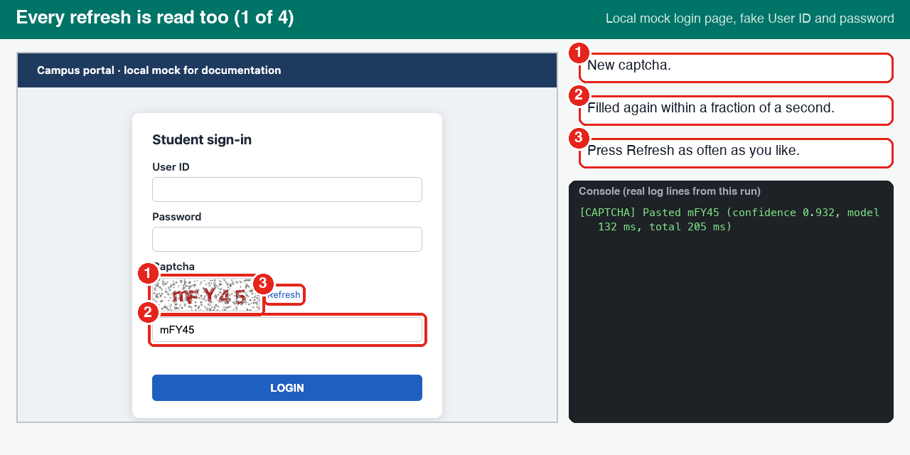</p>
<p align="center">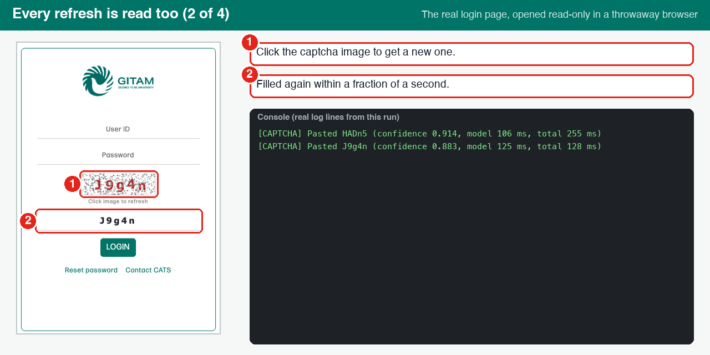</p>
<p align="center"></p>
<p align="center"></p>

</details>

### When does auto sign-in press LOGIN?

Pressing LOGIN is the risky part, because the extension assumes the site locks a User ID after 5 failed logins (see [Known limits](#known-limits)). So the extension decides on every page load, using what it can see:

| How the page was opened | Signs in? |
|---|---|
| Typed address, bookmark, link from another site | **Yes**, if auto sign-in is on |
| Arrived from a `gitam.edu` page (logout, session timeout) | Only with **Also sign in after logging out** |
| Reload, back/forward, restored tab | **Never** |
| Site said "Invalid CAPTCHA" after a press | One automatic retry (at most 2 presses per tab) |

In every case the credentials and captcha are still filled. These are real console lines from the shipped extension, from a test run against a local stand-in page (a real sign-in needs a real account):

<p align="center">
  
</p>

The full decision, taken from `content.js`:

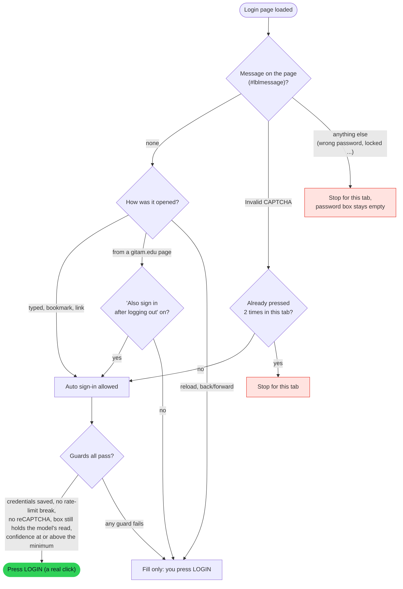

### When the site rejects a read

If you press LOGIN (or auto sign-in does) with the model's read unchanged and the reloaded page says "Invalid CAPTCHA", the captcha is saved to `Downloads/captcha_mistakes/<time>_model-<read>_conf-<confidence>.png` (time in UTC). A wrong password, a successful login or a code you retyped saves nothing. The right answer is unknown: the file name only says what the model read.

<p align="center">
  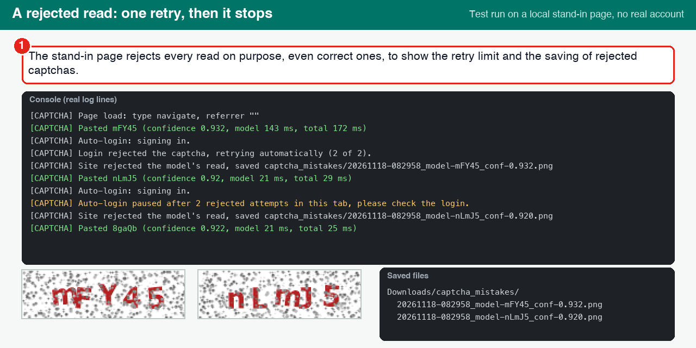
</p>

In this test run the local stand-in page rejects every read on purpose, even correct ones, to show the retry limit and the saving. The saved images are what the next training round uses ([TRAINING.md](docs/TRAINING.md#next-round-6)). A browser extension may only write under Downloads, so they land there first.

---

## How it works

### 1. Clean the image

The captcha has red letters over gray speckle and blobs. The extension turns each pixel into one of three levels, exactly as training did (`extension/model.js` `clean()` equals `scripts/prep.py` `clean()`):

```math
\text{pixel} =
\begin{cases}
0 & \text{if } r-g > 60 \text{ and } r-b > 60 \quad (\text{letter})\\
128 & \text{else if } r+g+b < 600 \quad (\text{blob})\\
255 & \text{otherwise} \quad (\text{paper})
\end{cases}
```

Keeping the blobs matters: a stroke hidden under a blob then looks different from no stroke, which is what separates the new bar-less **J** from a **3**.

<p align="center">
  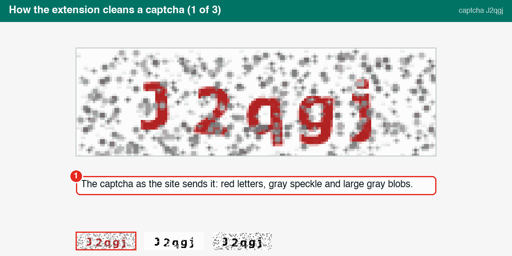
</p>

### 2. Read five characters

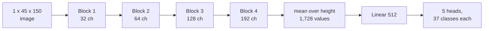

<p align="center">
  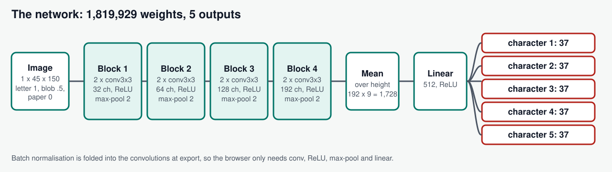
</p>

Each block is two 3x3 convolutions with ReLU and a 2x2 max-pool. BatchNorm is folded into the convolutions when the model is exported (`export_model.py`), so the browser needs only convolution, ReLU, max-pool and a linear layer, written as small WebAssembly SIMD kernels (`extension/model.wasm`). The alphabet has 37 case-sensitive characters, `2345689ABDEFGHJLMNQRTYabdefghijmnqrty` (the site never uses `0 O 1 l I 7`).

<p align="center">
  
</p>

The **confidence** shown in the console is the lowest of the five winning probabilities:

```math
\text{confidence} = \min_{k=1,\dots,5} \; \max_{j} \; \operatorname{softmax}(z_k)_j
```

so one doubtful character is enough to bring it down. (Training uses label smoothing 0.1, which is why a sure read tops out around 0.9 to 0.95, not 1.)

### 3. Where the model came from

The site changed its captcha twice in two days, and each change needed new data and a new model.

<p align="center">
  
</p>

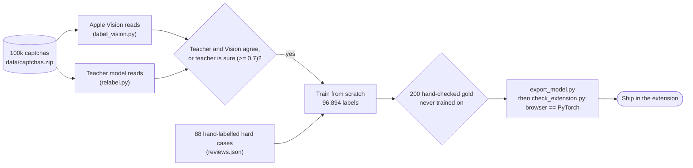

Gold is the only fair score: it is never trained on, relabelled or reviewed. The whole story, with training settings and test sets, is in [docs/CHANGELOG.md](docs/CHANGELOG.md); the recipe is in [docs/TRAINING.md](docs/TRAINING.md).

---

## Security

What the code does, checked against `extension/`:

| Property | How |
|---|---|
| **No network of its own** | The only `fetch` calls load the extension's own model files via `chrome.runtime.getURL`. There is no remote code, and no analytics. |
| **Narrow reach** | Permissions are `storage` and `downloads` only. The content script runs only on `*://login.gitam.edu/*`. |
| **Strict CSP** | Extension pages allow `script-src 'self' 'wasm-unsafe-eval'` (the WebAssembly kernels) and nothing else. |
| **Credentials** | Stored in `chrome.storage.local` on this machine: never synced to a browser account, never sent anywhere except by placing them in the login form, which is submitted by the page itself. **Not encrypted.** |
| **No credentials in the repository** | The settings form starts empty. |
| **Saved files are validated** | Only a PNG data URL, a 5-character alphanumeric read and a confidence between 0 and 1 are accepted, and the file always goes to `Downloads/captcha_mistakes/`. |
| **Lockout guards** | No retry after a wrong password, at most 2 presses per tab, nothing during a rate-limit break, nothing when Google reCAPTCHA is shown, nothing when the box no longer holds the model's read, nothing below the confidence minimum. |

> [!WARNING]
> The guards count per tab and start again whenever the login page is opened without a message. If the saved password is wrong, **every fresh open of the login page signs in once more** and costs one failed login. Correct the password (or untick auto sign-in) after the first failure.

> [!NOTE]
> This is a convenience tool for signing in to **your own** account. Whether using it is allowed under the site's terms is your responsibility.

---

## Known limits

- **Release 5.5 presses LOGIN on empty fields** when auto sign-in is on (the default on a fresh install) and no credentials are saved yet. The fix is in the source (`extension/content.js`, see the "Unreleased" entry in the [changelog](docs/CHANGELOG.md)) but not in a published zip. Until a new version ships, save your credentials first or untick both boxes.
- **A style change breaks it.** The model reads the current captcha style. If the site changes the captcha again, accuracy drops until a new round is trained ([TRAINING.md](docs/TRAINING.md#new-captcha-style)).
- **Confident misses exist.** v5 still rejects some captchas that it reads with confidence 0.90 to 0.93 (the project's own earlier notes), so the confidence minimum cannot catch them. Each costs one login attempt; auto sign-in retries once. The weakest known pair is **8 read as B**.
- **Hard-coded page.** It looks for the element ids `imgCaptcha`, `txtCaptchaInput`, `txtusername`, `password`, `Submit`, `lblmessage`. If the site renames them the console says `Captcha elements not found`.
- **No Google reCAPTCHA.** If the login shows reCAPTCHA instead of the image, auto sign-in does nothing.
- **The 5-attempt lockout is an assumption** taken from how the site behaved for the author; it is not in this repository and was not verified here.
- **What was and was not tested.** The model was tested against 200 hand-checked captchas and 8 real rejections, in Node against PyTorch. The extension flows (fill, auto sign-in, the rules, the rejected-captcha saving) were tested end to end in Chromium 145 against a **local stand-in page** (the real login page was only opened read-only, never signed in to). Signing in, the rules and the rejected-captcha saving were therefore not run on the live site, and Windows, Linux, Edge and Brave were not tested here.
- **Chromium only.** There is no Firefox or Safari build (a Safari port exists only for the old captchas, in `archive/`).

---

## Development

Everything is in the repository: the extension, the training notebooks, the data tools and the export script. The one check that matters runs the checkpoint through the extension's own `model.js` and `model.wasm` and through PyTorch, and fails unless all 208 reads match:

```sh
pip install -r requirements.txt        # torch, numpy, Pillow, jupyter, matplotlib, tqdm
python3 tools/check_extension.py       # JS == PyTorch on 208/208, gold 200/200, site 8/8
```

It needs `node` and the git-ignored `data/captchas.zip`. Shipping a new model, releasing, and rebuilding the pictures in this README are in [docs/DEVELOPMENT.md](docs/DEVELOPMENT.md).

<details>
<summary><b>Repository layout</b></summary>

| Path | What |
|---|---|
| `extension/` | The extension. Load unpacked from here. |
| `models/` | `captcha_cnn_v5.pt` (shipped) and its teacher `captcha_cnn_v4_ft.pt`. |
| `notebooks/`, `scripts/`, `tools/` | Training round, data tools, pre-ship check, README picture scripts. |
| `data/` | Gold set, reviews, labels, the 8 rejected captchas. The captcha zip is git-ignored. |
| `docs/` | Changelog, training and development guides, pictures. |
| `archive/` | Frozen earlier work (older styles, Vision and native-host versions). |

</details>

---

## Documentation map

| Document | What is in it |
|---|---|
| [docs/CHANGELOG.md](docs/CHANGELOG.md) | Every extension version: what changed, why, settings, how it was tested. |
| [docs/TRAINING.md](docs/TRAINING.md) | Data, labelling, the next training round, rules that keep scores meaningful. |
| [docs/DEVELOPMENT.md](docs/DEVELOPMENT.md) | Layout, checks, shipping, releasing, rebuilding the pictures. |
| [extension/README.txt](extension/README.txt) | The text that ships inside the zip. |
| [archive/README.md](archive/README.md) | Index of the frozen snapshots. |
