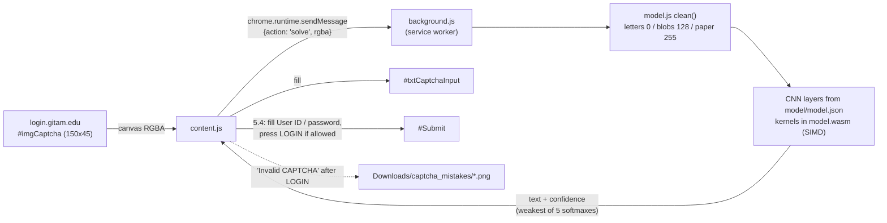
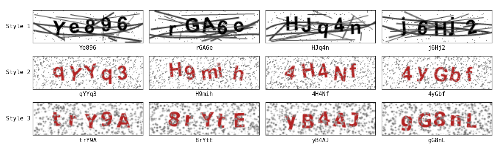

# Instant CAPTCHA Paster: version history

A Chrome/Edge/Brave extension that reads the 5-character image CAPTCHA on `login.gitam.edu` with a small CNN
running inside the browser (WebAssembly), pastes the answer, and since 5.4 can also fill your credentials and sign
you in. This document covers every version: what changed, why, how it works, the configuration choices, and how
each version was tested.

- [At a glance](#at-a-glance)
- [How it works today](#how-it-works-today)
- [The three captcha styles](#the-three-captcha-styles)
- [Versions](#versions): [5.5](#55--2026-11-11-auto-sign-in-rules) · [5.4](#54--2026-11-10-auto-login) · [5.3](#53--2026-11-01-v5-gold-100) ·
  [5.2](#52--2026-10-31-style-3-three-level-cleaning) · [5.1](#51--2026-10-31-save-rejected-captchas) ·
  [5.0](#50--2026-10-30-style-2-red-letters) · [4.1 and earlier](#41-and-earlier--2026-09-30-from-apple-vision-to-an-in-browser-cnn)
- [How models are tested](#how-models-are-tested)
- [Known weak spots](#known-weak-spots)

## At a glance

| Extension | Date | Captcha style | Model | Gold (hand-checked) | Headline change |
|---|---|---|---|---|---|
| **5.5** | 2026-11-11 | 3 | v5 | **200/200 (100%)** | Auto sign-in rules: site opens, optional after logout, never reload |
| 5.4 | 2026-11-10 | 3 | v5 | 200/200 (100%) | Auto-login: credential fill + optional sign-in |
| 5.3 | 2026-11-01 | 3 | v5 | 200/200 (100%) | New model (round 5) |
| 5.2 | 2026-10-31 | 3 | v4 | 194/200 (97.0%) | Three-level image cleaning for the new blob style |
| 5.1 | 2026-10-31 | 2 | v2_ft | 197/200 (98.5%) on style 2 | Saves captchas the site rejects |
| 5.0 | 2026-10-30 | 2 | v2_ft | 197/200 (98.5%) on style 2 | Red-letter mask for the new style |
| 4.1 | 2026-09-30 | 1 | v1 ft_650 | 142/152 (93.4%) on style 1 | CNN moved into the extension (WASM) |
| (pre-4.1) | 2026-09 | 1 | Apple Vision OCR | ~76% | Native helper app on macOS |

Gold sets are per captcha style, so scores are only comparable within a style.

## How it works today

- **Image cleaning** (`extension/model.js` `clean()`, identical to `scripts/prep.py` `clean()`): a pixel is a
  *letter* (0) when `r - g > 60 && r - b > 60`, else a *blob* (128) when `r + g + b < 600`, else *paper* (255).
  The network sees `1 - gray/255`.
- **Network**: 4 blocks of (conv3x3-BN-ReLU x2, maxpool 2), widths 32/64/128/192; input 1x45x150 -> 192x2x9 ->
  mean over height -> 1,728 -> Linear 512 -> 5 heads of Linear 37 (one per character position). 1,819,929 weights
  (7.3 MB, float32). BatchNorm is folded into the convolutions at export (`export_model.py`).
- **Alphabet** (37 characters, case-sensitive): `2345689ABDEFGHJLMNQRTYabdefghijmnqrty`. The site never uses
  0/O/1/l/I/7.
- **Confidence** = the lowest of the five per-position softmax probabilities. Below ~0.5 the read is a guess.
- **Speed**: ~30 ms per captcha in Node; the console shows it as `[CAPTCHA] Pasted mMy2g (confidence 0.922, model 30 ms, total 60 ms)`.
- **No dependencies**: no Python, no native host, no network calls. Works in any Chromium browser on macOS, Linux
  and Windows. The manifest's CSP allows `'wasm-unsafe-eval'` for the WASM kernels.

## The three captcha styles

The site changed its captcha twice in two days. Each change needed new data, new cleaning and a new model.

| Style | Live | Look | What the cleaning keeps |
|---|---|---|---|
| 1 | until 2026-10-30 | black letters crossed by gray lines | grayscale (Pillow `convert("L")`) |
| 2 | 2026-10-30 to 10-31 | red letters on fine gray speckle | red pixels only (two-level) |
| 3 | since 2026-10-31 (between 03:02 and 08:04 UTC) | red, bolder font, large soft gray blobs over the letters | red letters + blobs (three-level) |

Each style's captchas (100k–127k per style, all 150x45 PNG) live in one zip, read directly by `prep.py` without
unpacking. Ids repeat across styles, so labels never move between style workspaces.

---

## Versions

### 5.5 — 2026-11-11: auto sign-in rules

**Model unchanged (v5).** Auto-login now has rules for *when* it presses LOGIN (`loadKind()` in `content.js`):

| Page load | Sign in? |
|---|---|
| Typed URL, bookmark, link from another site (navigation type `navigate`, referrer not on `gitam.edu`) | yes (if "Sign in automatically" is on) |
| Arrived from a `gitam.edu` page: logout, session timeout | only with the new sub-box **Also sign in after logging out** (`signInAfterLogout`, default off, disabled unless auto sign-in is on) |
| Reload, back/forward, restored tab | never (changed from 5.4, which signed in on reloads too) |
| "Invalid CAPTCHA" retry | unchanged (max 2 presses per tab) |

Credentials and captcha are still filled in every case; LOGIN is left to you. The decision now runs after the settings
load (`fillCredentials`). Each load logs `[CAPTCHA] Page load: type ..., referrer ...`. Links from other `gitam.edu`
pages count as "logout" (same referrer).

**Tests.** Logging out of the portal (`gstudent.gitam.edu/Home/Logout`) lands on `login.gitam.edu/Login.aspx` with navigation
type `navigate`, referrer `https://gstudent.gitam.edu/` and an empty `#lblmessage`, so it is classed "internal". The
sign-in decision itself still needs a run of 5.5 on the live site (the browser was still running 5.4 during that check).
Cleanup in this release: removed a dead "unsure" branch and the unused `raw` field (the model always returns a 5-character read); `tools/check_extension.py` still JS == PyTorch on 208/208. No automated test of the sign-in rules (needs the live site). 5.4 is frozen in `archive/extension_5.4_2026-11-11/`.

---

### 5.4 — 2026-11-10: auto-login

**Model unchanged (v5).** This release is about the login itself.

**What's new**
- **Toolbar popup and options page** (`popup.html`, `options.html`, shared logic in `settings-ui.js`) with:
  User ID, password, *minimum CAPTCHA confidence to press LOGIN*, and two checkboxes:
  - **Auto populate credentials only**: fills the User ID, password and captcha; you press LOGIN.
  - **Sign in automatically on login.gitam.edu**: also presses LOGIN. Ticking it ticks the first box
    automatically (signing in needs the credentials filled); unticking the first box unticks it.
- **Icons and logo** for the toolbar and popup.
- **New permission**: `storage` (for the settings).

**How the sign-in stays safe**

The site locks a User ID after 5 failed logins, so `content.js` only presses LOGIN when every guard passes:

| Situation (read from `#lblmessage` after the reload) | What the extension does |
|---|---|
| No message (fresh page) | Fill, and press LOGIN once if "Sign in automatically" is on |
| "Invalid CAPTCHA" | One automatic retry with the new captcha (max 2 presses per tab, counted in `sessionStorage`) |
| Any other message (wrong password, locked, ...) | Stop for this tab, don't refill the password |
| Rate-limit break on screen (`#lblRateLimit`) | Do nothing |
| Google reCAPTCHA shown (`#pnlGoogleCaptcha`) | Do nothing (the model can't read it) |
| Model confidence below the minimum (default 0.5) | Fill the captcha, leave LOGIN to you |
| The captcha box no longer holds the model's read | Do nothing (you typed something) |

LOGIN is a real `click()` on `#Submit`, so the site's own validation runs and the rejected-captcha saving from 5.1
keeps working.

**Configuration choices**

| Setting | Default | Why |
|---|---|---|
| `autofill` | on | Filling is harmless; pressing LOGIN is the risky part |
| `autoLogin` | on | Opening the page is enough to sign in; implies `autofill` |
| `minConfidence` | 0.5 | Below ~0.5 a read is a guess, so it never burns one of the 5 attempts (it can't catch confident misses, see [Known weak spots](#known-weak-spots)) |
| `MAX_ATTEMPTS` | 2 | First press + one retry after "Invalid CAPTCHA"; the site's 5 stays out of reach |
| Storage | `chrome.storage.local` | Stays on this machine, never synced to a browser account |

The password is stored unencrypted in the extension's local storage: don't use auto-login on a shared computer.
Nothing about your credentials is in this repository; the form starts empty.

**Tests**
- `tools/check_extension.py` (v5 through the extension's own `model.js` + `model.wasm` in Node vs PyTorch):
  JS == PyTorch on 208/208, gold 200/200, site rejections 8/8, max confidence difference 1e-6.
- The 5.4 build first arrived with v4's weights (gold 97%); it was merged keeping v5 and re-checked as above.
- The auto-login flow itself has no automated test (it needs the live site); the guards above were reviewed by hand.

---

### 5.3 — 2026-11-01: v5, gold 100%

**Problem.** v4 (5.2) scored 97% on gold, missing 6 read as 5, J read as 3, and y read as Y. Its training labels
came from v3 + Apple Vision agreement, which under-represents exactly those hard characters.

**What changed**
1. **v4_ft**: v4 fine-tuned on 88 hard style-3 captchas (v4's weakest reads), labelled from the image
   (`data/reviews.json`, spot-checked). Gold 100%, but it newly read some 8 as B and 9 as g.
2. **Round 5** (`notebooks/train_v5.ipynb`, run headless with `tools/run_round.py`):
   v4_ft relabels all 100k captchas; a label is kept when v4_ft agrees with Vision **or** its weakest character is
   >= 0.7 (`MIN_CONF`; 4.2% dropped), plus the 88 reviews. Train **from scratch** (the teacher's weights would carry
   its mistakes over: fine-tuning from v4 scored lower in the 5.2 experiment).

**Training configuration (round 5)**

| | |
|---|---|
| Data | 96,894 labelled captchas: 67,852 train (incl. 88 reviews) / 19,361 test / 9,681 val, + 200 gold (never trained on) |
| Optimizer | AdamW, lr 2e-3, weight decay 1e-4, OneCycle schedule |
| Batch / epochs | 256 / 10 (early stop after 4 epochs without val gain) |
| Regularisation | dropout 0.3, label smoothing 0.1 |
| Augmentation | random shift ±4 px and rotation ±4° per image, on the GPU; no flips (a mirrored letter is another letter) |
| Kept epoch | best val exact-match (99.76%, epoch 7) |
| Hardware | Apple Silicon `mps`, ~75 s per epoch |

**Results**

| Model | Gold | Site (8) | Disputed (20) | Notes |
|---|---|---|---|---|
| v4 (5.2) | 97.0% | 8/8 | 5/20 | 6->5, J->3, y->Y |
| v4_ft | 100% | 8/8 | 15/20 | reads some 8 as B, 9 as g |
| **v5 (5.3)** | **100%** | **8/8** | **19/20** | one 8 read as B; test 99.63% exact |

"Disputed" = the 20 test captchas where v4 and v4_ft disagree, truth read by eye: the best check left once gold is
saturated. Gold hit 100% from epoch 3 on and stayed at 99.5–100% after.

---

### 5.2 — 2026-10-31: style 3, three-level cleaning

**Problem.** Overnight the site switched to style 3: a bolder font with large gray blobs drawn over the letters.
5.1's model (v2_ft) failed on it. The new **J has no top bar**, so every older model read it as **3**.

**Why three levels.** Keeping only red pixels (two-level, `prep.ink`) leaves holes wherever a blob covers part of a
letter. A J with its top hidden looks exactly like a 3 with its top hidden; a 6 with its loop half-covered looks
like a 5. Marking blob pixels as mid-gray (128) tells the network "something may be under here" instead of "no
stroke here":

**The experiment behind the switch** (`archive/three_level_switch_2026-10-31/`). Same labels (v4's own reads with
confidence >= 0.7, 93,185 captchas), same 70/20/10 split, from scratch, 10 epochs, several seeds:

| Input | Seeds | Val | Gold (mean) | Gold, mean of epochs 3–10 | Top gold confusions (summed over seeds) |
|---|---|---|---|---|---|
| two-level (binary) | 3 | **99.54%** | 94.5% | 95.3% | 6->5 x15, J->3 x9 |
| raw RGB | 2 | 98.70% | 96.0% | 96.3% | 6->5 x7, J->3 x4 |
| **three-level** | 3 | 98.99% | **96.3%** | **96.9%** | 6->5 x11, J->3 x6 |

Two-level scored highest on validation but lowest on gold: it learned to copy the teacher's mistakes. Three-level
won on gold and is a single channel (cheap in the browser), so the project switched to it. v4 retrained three-level
went from 94.5% to **97.0%** on gold, and from 6/8 to **8/8** on the site's rejections.

**Round 4 recipe**: labels from v3 + Apple Vision agreement, with Vision trusted for J where v3 reads 3
(`VISION_FIXES`, 23/23 right in a 500-captcha sample); trained from v3's weights.

**Other changes**
- Checkpoints and `model.json` carry `levels` (2 or 3), so two-level models keep working in the same `model.js`.
- `tools/check_extension.py`: the pre-ship check (see [How models are tested](#how-models-are-tested)).
- The 8 captchas the site rejected from 5.1 became the "site" test set (`data/site_mistakes/`):

Almost every miss is one character, and almost always J/3, 6/5, B/8, a/e or y/Y.

---

### 5.1 — 2026-10-31: save rejected captchas

**What's new.** When you press LOGIN with the model's read unchanged and the reloaded page says "Invalid CAPTCHA",
the captcha is saved to `Downloads/captcha_mistakes/<time>_model-<read>_conf-<confidence>.png` (time UTC).

**How.** On submit, `content.js` keeps the image (PNG data URL), read and confidence in `sessionStorage`, which
survives the login POST. On the reloaded page it checks `#lblmessage`; if it mentions the captcha, `background.js`
saves the image through `chrome.downloads` (extensions can only write under Downloads). Wrong passwords, successful
logins and codes you retyped save nothing. New permission: `downloads`.

**Why.** These are real-world misses: the most valuable images for the next training round, and they became the
site test set in 5.2.

---

### 5.0 — 2026-10-30: style 2, red letters

**Problem.** The site switched from black letters crossed by gray lines to red letters on gray speckle. The v1
model (4.1) scored 91.0% on the new gold.

**What changed**
- New workspace; v1 frozen in `archive/v1_2026-10-30/`.
- **Red-letter mask**: a pixel is ink when `r - g > 60 && r - b > 60` (speckle is gray, r = g = b), in both
  `prep.py` and `model.js`.
- 100,000 new captchas labelled by Apple Vision (`scripts/label_vision.py`), and a new 200-captcha gold set
  (`scripts/audit_gold.py`).
- **Round 2**: train on v1-model / Vision agreement -> v2 96.0%; review 100 hard cases and fine-tune -> **v2_ft
  98.5%**. **Round 3** (relabel with v2_ft, retrain from scratch) tied at 98.5%, so v2_ft shipped.
- JS output verified identical to PyTorch on all 200 gold.

---

### 4.1 and earlier — 2026-09-30: from Apple Vision to an in-browser CNN

| Stage | How it read the captcha | Gold (style 1) |
|---|---|---|
| Vision extension | Image cleanup + Apple Vision OCR through a macOS native-messaging host | ~76% |
| CNN + native host | PyTorch CNN in a local Python host | 86.8% (v1, Vision labels) |
| **4.1** | Same CNN exported to JSON + weights, run in the extension with WASM SIMD kernels (`kernels.c`) | **93.4%** (v1 fine-tuned on 650 reviews) |

4.1 removed every outside dependency: no Python, no helper app, works on any OS. A Safari port existed for 4.1
only. All of this is frozen in `archive/` (`vision_extension_2026-09-30/`, `cnn_native_host_2026-09-30/`,
`v1_2026-10-30/`).

---

## How models are tested

| Test set | Size | What it measures |
|---|---|---|
| **Gold** (`data/gold.csv`) | 200 per style | Hand-checked labels. **Never trained on, relabelled or reviewed**; the only fair comparison between models |
| **Site** (`data/site_mistakes/`) | 8 (style 3) | Captchas the live site actually rejected; truth read from the image |
| **Disputed** | 20 | Test captchas where two strong models disagree, truth read by eye; used once gold saturated |
| Val / test | ~10k / ~19k | Only agreement with the teacher's labels: useful for early stopping, not for accuracy |

**Pre-ship check** (`python3 tools/check_extension.py [model.pt]`): exports the checkpoint to a temp folder, then
reads every gold and site captcha twice: with PyTorch, and with the extension's own `model.js` + `model.wasm` in
Node (`tools/check_extension.mjs`). Every read must match, or the model doesn't ship. Every release since 5.2 passed
it (208/208); 5.0 was verified JS == PyTorch on its 200 gold before that tool existed.

**Rules that keep scores meaningful**
- Gold is skipped by every relabel, review and training script.
- `prep.clean` and `model.js clean()` must stay identical; change both or neither, then re-export.
- The previous release's zip is kept in `dist/` as the rollback.

## Known weak spots

- **8 vs B** is the last confusion v5 shows (1 of the 20 disputed captchas).
- 4 captchas rejected by 5.3 (2026-11-02 to 11-06) are waiting in `~/Downloads/captcha_mistakes/`, read by v5
  with confidence **0.90–0.93**: confident misses the `minConfidence` guard cannot catch (each costs one login
  attempt; auto-login retries once). They are the starting point for round 6: gold is saturated at 100%, so real
  misses are now the score that matters.
- If the site changes style again, the workflow is in the main `README.md` ("New captcha style").
