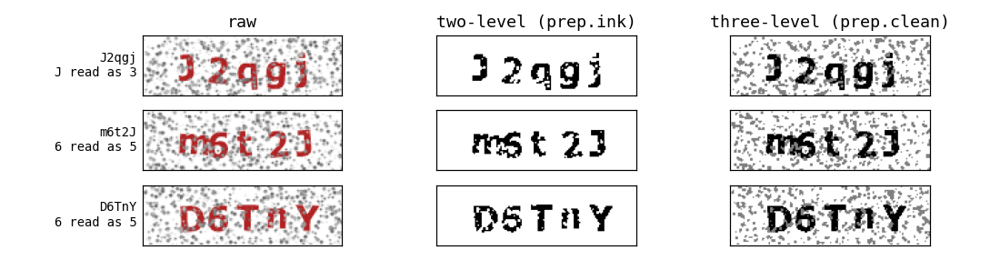
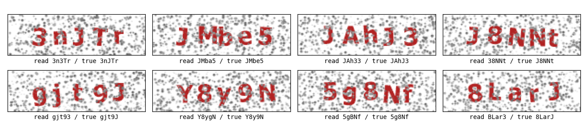

# Changelog

Every version of the extension: what changed, why, and how it was tested. For how the thing works, see [HOW_IT_WORKS.md](HOW_IT_WORKS.md).

| Extension | Date | Captcha style | Model | Gold (hand-checked) | What changed |
|---|---|---|---|---|---|
| 5.5 | 2026-11-11 | 3 | v5 | 200/200 | Rules for when auto sign-in presses LOGIN |
| 5.4 | 2026-11-10 | 3 | v5 | 200/200 | Auto-login: fills credentials, optionally signs in |
| 5.3 | 2026-11-01 | 3 | v5 | 200/200 | New model (round 5) |
| 5.2 | 2026-10-31 | 3 | v4 | 194/200 | Three-level cleaning for the new blob style |
| 5.1 | 2026-10-31 | 2 | v2_ft | 197/200 (style 2) | Saves captchas the site rejects |
| 5.0 | 2026-10-30 | 2 | v2_ft | 197/200 (style 2) | Red-letter mask for the new style |
| 4.1 | 2026-09-30 | 1 | v1 ft_650 | 142/152 (style 1) | CNN moved into the extension (WASM) |
| before 4.1 | 2026-09 | 1 | Apple Vision OCR | about 76% | Native helper app on macOS |

Gold sets are per captcha style, so scores only compare within a style.

## The three captcha styles

The site changed its captcha twice in two days. Each time it needed new data, new cleaning and a new model.

| Style | Live | Look | What the cleaning keeps |
|---|---|---|---|
| 1 | until 2026-10-30 | black letters crossed by gray lines | grayscale |
| 2 | 2026-10-30 to 10-31 | red letters on fine gray speckle | red pixels only (two-level) |
| 3 | since 2026-10-31 (between 03:02 and 08:04 UTC) | red, bolder font, big soft gray blobs over the letters | red letters plus blobs (three-level) |

Each style's captchas (100k to 127k of them, all 150x45 PNG) live in one zip that `prep.py` reads directly. Ids repeat across styles, so labels never move between style workspaces.

## Unreleased (not in the 5.5 zip)

- **Fix:** with auto sign-in on (the default on a fresh install) and no credentials saved, the extension pressed LOGIN on empty fields. `maybeAutoSubmit` now returns early unless a User ID and password are saved.
- **Text:** the options page used to say the 5-attempt lockout "can never" be reached. It can: the attempt counters live in per-tab `sessionStorage` and reset when the login page is opened without a message, so a wrong saved password costs one failed login per fresh open. The text now says that.

## 5.5 (2026-11-11): auto sign-in rules

Model unchanged (v5). Auto-login now decides whether to press LOGIN based on how the page was opened (`loadKind()` in `content.js`):

| Page load | Signs in? |
|---|---|
| Typed URL, bookmark, link from another site (navigation type `navigate`, referrer not on `gitam.edu`) | Yes, if "Auto sign-in when the site is opened" is on |
| Arrived from a `gitam.edu` page (logout, session timeout) | Only with the new sub-box **Also sign in after logging out** (`signInAfterLogout`, off by default, disabled unless auto sign-in is on) |
| Reload, back/forward, restored tab | Never. 5.4 signed in on reloads too. |
| "Invalid CAPTCHA" retry | Unchanged, at most 2 presses per tab |

Credentials and the captcha are still filled in every case. The decision now runs after the settings load (`fillCredentials`), and each load logs `[CAPTCHA] Page load: type ..., referrer ...`. A link from any other `gitam.edu` page counts as a logout, because the referrer is the same.

**Testing.** Logging out of the student portal lands on `login.gitam.edu/Login.aspx` with navigation type `navigate`, referrer `https://gstudent.gitam.edu/` and an empty `#lblmessage`, so it's classed as coming from inside the site. I didn't run the sign-in decision on the live site, because my browser was still on 5.4 during that check. Later I ran it against a local copy of the login page (`tools/readme_visuals/`, the actual extension, fake credentials): a typed address signs in, a reload doesn't, and a logout redirect from a fake `gstudent.gitam.edu` page signs in only with the sub-box ticked. That confirms the rules in code, not on the live site.

Cleanup in the same release: removed a dead "unsure" branch and the unused `raw` field (the model always returns a 5-character read). `tools/check_extension.py` still gives JS == PyTorch on 208/208. 5.4 is kept in `archive/extension_5.4_2026-11-11/`.

## 5.4 (2026-11-10): auto-login

Model unchanged (v5). This one is about the login itself.

New:

- A toolbar popup and an options page (`popup.html`, `options.html`, shared logic in `settings-ui.js`) with User ID, password, the minimum confidence to press LOGIN, and two checkboxes:
  - **Auto populate credentials only** fills User ID, password and captcha. You press LOGIN.
  - **Sign in automatically on login.gitam.edu** (called "Auto sign-in when the site is opened" since 5.5) also presses LOGIN. Ticking it ticks the first box, since signing in needs the credentials filled. Unticking the first box unticks it.
- Icons and a logo for the toolbar and popup.
- The `storage` permission, for the settings.

The site locks a User ID after 5 failed logins (an assumption, see the README), so `content.js` looks at the page after every reload (mostly `#lblmessage`) before it presses LOGIN:

| Situation | What it does |
|---|---|
| No message (fresh page) | Fills, and presses LOGIN once if auto sign-in is on |
| "Invalid CAPTCHA" | One automatic retry with the new captcha (max 2 presses per tab, counted in `sessionStorage`) |
| Any other message (wrong password, locked...) | Stops for this tab and doesn't refill the password |
| Rate-limit break on screen (`#lblRateLimit`) | Does nothing |
| Google reCAPTCHA showing (`#pnlGoogleCaptcha`) | Does nothing, the model can't read it |
| Confidence below the minimum (default 0.5) | Fills the captcha, leaves LOGIN to you |
| The captcha box no longer holds the model's read | Does nothing, you typed something |

LOGIN is a real `click()` on `#Submit`, so the site's own validation runs and the rejected-captcha saving from 5.1 keeps working.

Defaults, and why:

- `autofill` on: filling is harmless, pressing LOGIN is the risky part.
- `autoLogin` on: opening the page is enough to sign in. It implies `autofill`.
- `minConfidence` 0.5: below that a read is a guess, so it never spends one of the 5 attempts. It can't catch confident misses (see [Known weak spots](#known-weak-spots)).
- `MAX_ATTEMPTS` 2: the first press plus one retry after "Invalid CAPTCHA", which keeps the site's 5 out of reach.
- Storage is `chrome.storage.local`, so it stays on the machine and isn't synced to a browser account.

The password is stored unencrypted in the extension's local storage, so don't use auto-login on a shared computer. Nothing about anyone's credentials is in this repo.

**Testing.** `tools/check_extension.py` on v5 gave JS == PyTorch on 208/208, gold 200/200, site rejections 8/8, max confidence difference 1e-6. The 5.4 build first came out with v4's weights (gold 97%); I merged it keeping v5 and re-checked. The auto-login flow itself had no automated test, since it needs the live site. I went over the guards by hand.

## 5.3 (2026-11-01): v5, gold 100%

**Problem.** v4 (5.2) scored 97% on gold. It missed 6 read as 5, J read as 3, and y read as Y. Its training labels came from v3 and Apple Vision agreeing, which under-represents exactly those hard characters.

What I did:

1. **v4_ft**: v4 fine-tuned on 88 hard style-3 captchas (v4's weakest reads), labelled from the image (`data/reviews.json`, spot-checked). Gold went to 100%, but it started reading some 8 as B and 9 as g.
2. **Round 5** (`notebooks/train_v5.ipynb`, run headless with `tools/run_round.py`): v4_ft relabels all 100k captchas. A label is kept when v4_ft agrees with Vision, or when its weakest character is at least 0.7 (`MIN_CONF`). That drops 2,906 of the 99,800 non-gold captchas, 2.9%. The 88 reviews go in too. Then I trained from scratch, because the teacher's weights would carry its mistakes over (fine-tuning from v4 scored lower in the 5.2 experiment).

Training settings for round 5:

- Data: 96,894 labelled captchas, split 67,852 train (including the 88 reviews), 19,361 test, 9,681 val, plus 200 gold that is never trained on
- AdamW, learning rate 2e-3, weight decay 1e-4, OneCycle schedule
- Batch 256, 10 epochs, early stop after 4 epochs without a val gain
- Dropout 0.3, label smoothing 0.1
- Random shift of up to 4 px and rotation of up to 4 degrees per image, done on the GPU. No flips, since a mirrored letter is a different letter.
- Kept the epoch with the best val exact-match (99.76%, epoch 7)
- Apple Silicon `mps`, about 75 s per epoch

| Model | Gold | Site (8) | Disputed (20) | Notes |
|---|---|---|---|---|
| v4 (5.2) | 97.0% | 8/8 | 5/20 | 6 as 5, J as 3, y as Y |
| v4_ft | 100% | 8/8 | 15/20 | reads some 8 as B, 9 as g |
| **v5 (5.3)** | **100%** | **8/8** | **19/20** | one 8 read as B; test 99.63% exact |

"Disputed" is the 20 test captchas where v4 and v4_ft disagree, with the truth read by eye. It's the best check I had left once gold was maxed out. Gold hit 100% from epoch 3 and stayed between 99.5% and 100% after that.

## 5.2 (2026-10-31): style 3, three-level cleaning

**Problem.** Overnight the site switched to style 3: a bolder font with large gray blobs drawn over the letters. 5.1's model (v2_ft) failed on it. The new **J** has no top bar, so every older model read it as a **3**.

**Why three levels.** Keeping only the red pixels (two-level, `prep.ink`) leaves holes wherever a blob covers part of a letter. A J with its top hidden looks exactly like a 3 with its top hidden, and a 6 with a half-covered loop looks like a 5. Marking blob pixels as mid-gray (128) tells the network "something may be under here" rather than "no stroke here".

**The experiment** (`archive/three_level_switch_2026-10-31/`): same labels (v4's own reads with confidence at least 0.7, 93,185 captchas), same 70/20/10 split, from scratch, 10 epochs, several seeds.

| Input | Seeds | Val | Gold (mean) | Gold, mean of epochs 3-10 | Top gold confusions (summed over seeds) |
|---|---|---|---|---|---|
| two-level | 3 | **99.54%** | 94.5% | 95.3% | 6 as 5 x15, J as 3 x9 |
| raw RGB | 2 | 98.70% | 96.0% | 96.3% | 6 as 5 x7, J as 3 x4 |
| **three-level** | 3 | 98.99% | **96.3%** | **96.9%** | 6 as 5 x11, J as 3 x6 |

Two-level scored best on validation and worst on gold: it learned to copy the teacher's mistakes. Three-level won on gold and is still a single channel, which is cheap in the browser, so I switched. v4 retrained three-level went from 94.5% to **97.0%** on gold, and from 6/8 to **8/8** on the site's rejections.

Round 4 recipe: labels from v3 and Apple Vision agreeing, with Vision trusted for J where v3 says 3 (`VISION_FIXES`, 23 of 23 right in a 500-captcha sample), trained from v3's weights.

Other changes:

- Checkpoints and `model.json` carry `levels` (2 or 3), so two-level models still work in the same `model.js`.
- `tools/check_extension.py`, the pre-ship check (see [How models are tested](#how-models-are-tested)).
- The 8 captchas the site rejected from 5.1 became the "site" test set (`data/site_mistakes/`).

Nearly every miss is one character, and nearly always J/3, 6/5, B/8, a/e or y/Y.

## 5.1 (2026-10-31): save rejected captchas

When you press LOGIN with the model's read unchanged and the reloaded page says "Invalid CAPTCHA", the captcha is saved to `Downloads/captcha_mistakes/<time>_model-<read>_conf-<confidence>.png` (time in UTC).

On submit, `content.js` keeps the image (as a PNG data URL), the read and the confidence in `sessionStorage`, which survives the login POST. On the reloaded page it checks `#lblmessage`, and if it mentions the captcha, `background.js` saves the image through `chrome.downloads` (extensions can only write under Downloads). Wrong passwords, successful logins and codes you retyped save nothing. New permission: `downloads`.

I added this because real misses are the most useful images for the next training round. They became the site test set in 5.2.

## 5.0 (2026-10-30): style 2, red letters

**Problem.** The site switched from black letters crossed by gray lines to red letters on gray speckle. The v1 model (4.1) scored 91.0% on the new gold.

- New workspace, with v1 frozen in `archive/v1_2026-10-30/`.
- **Red-letter mask:** a pixel is ink when `r - g > 60 && r - b > 60` (the speckle is gray, so r = g = b), in both `prep.py` and `model.js`.
- 100,000 new captchas labelled by Apple Vision (`scripts/label_vision.py`), and a new 200-captcha gold set (`scripts/audit_gold.py`).
- Round 2: trained on v1-model/Vision agreement for v2 at 96.0%, then reviewed 100 hard cases and fine-tuned for **v2_ft at 98.5%**. Round 3 (relabel with v2_ft, retrain from scratch) tied at 98.5%, so v2_ft shipped.
- JS output checked identical to PyTorch on all 200 gold.

## 4.1 and earlier (2026-09-30): from Apple Vision to an in-browser CNN

| Stage | How it read the captcha | Gold (style 1) |
|---|---|---|
| Vision extension | Image cleanup plus Apple Vision OCR through a macOS native-messaging host | about 76% |
| CNN + native host | PyTorch CNN in a local Python host | 86.8% (v1, Vision labels) |
| **4.1** | The same CNN exported to JSON plus weights, run in the extension with WASM SIMD kernels (`kernels.c`) | **93.4%** (v1 fine-tuned on 650 reviews) |

4.1 got rid of every outside dependency: no Python, no helper app, works on any OS. A Safari port existed for 4.1 only. All of this is in `archive/` (`vision_extension_2026-09-30/`, `cnn_native_host_2026-09-30/`, `v1_2026-10-30/`).

## How models are tested

| Test set | Size | What it tells you |
|---|---|---|
| **Gold** (`data/gold.csv`) | 200 per style | Hand-checked labels. Never trained on, relabelled or reviewed, so it's the only fair comparison between models. |
| **Site** (`data/site_mistakes/`) | 8 (style 3) | Captchas the live site actually rejected, with the truth read from the image. |
| **Disputed** | 20 | Test captchas where two strong models disagree, truth read by eye. Used once gold maxed out. |
| Val / test | about 10k / 19k | Only agreement with the teacher's labels. Good for early stopping, not for accuracy. |

The pre-ship check (`python3 tools/check_extension.py [model.pt]`) exports the checkpoint to a temp folder, then reads every gold and site captcha twice: with PyTorch, and with the extension's own `model.js` and `model.wasm` in Node (`tools/check_extension.mjs`). Every read has to match or the model doesn't ship. Every release since 5.2 passed it (208/208). 5.0 was checked JS == PyTorch on its 200 gold before the tool existed.

Rules that keep scores meaningful:

- Every relabel, review and training script skips gold.
- `prep.clean` and `model.js` `clean()` stay identical. Change both or neither, then re-export.
- Keep the previous release's zip in `dist/` as the rollback.

## Known weak spots

- **8 vs B** is the last confusion v5 shows (1 of the 20 disputed captchas).
- As of 2026-11-10, four captchas rejected by 5.3 (between 11-02 and 11-06) were sitting in `~/Downloads/captcha_mistakes/`. v5 had read them with confidence 0.90 to 0.93, which is the kind of confident miss the `minConfidence` setting can't catch. Each costs a login attempt, and auto-login retries once. They're where round 6 starts: gold is maxed out, so real misses are the score that matters now.
- If the site changes style again, the steps are in [TRAINING.md](TRAINING.md#new-captcha-style).
