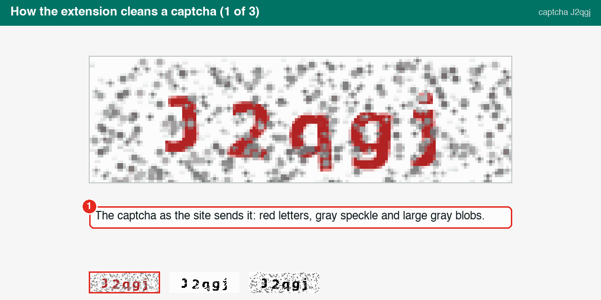
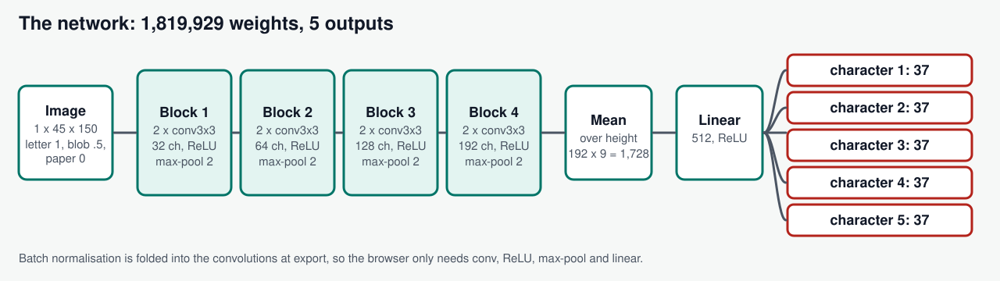
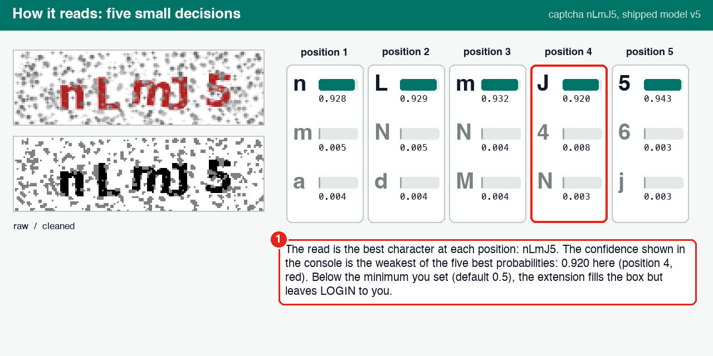
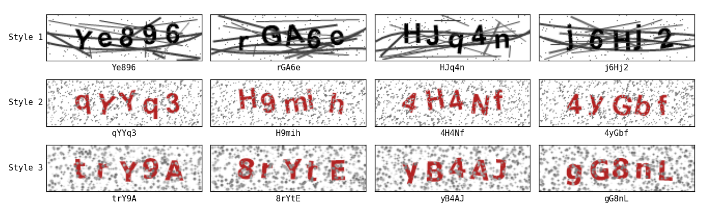
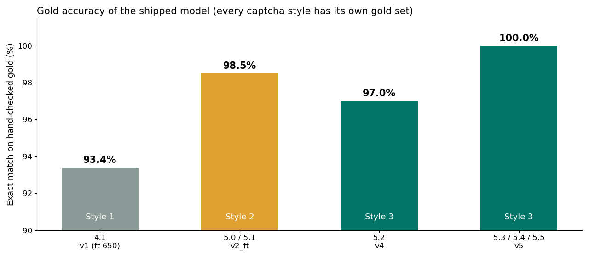

# How it works

The short version: clean the picture, run it through a small network, take the most likely character at each of the five positions. All of it happens in the browser.

## 1. Cleaning the image

The current captcha is red letters with gray speckle and gray blobs on top. Each pixel is turned into one of three values, exactly the same way during training and in the extension (`clean()` in `extension/model.js` matches `clean()` in `scripts/prep.py`):

- **0 (letter)** if `r - g > 60` and `r - b > 60`
- **128 (blob)** otherwise, if `r + g + b < 600`
- **255 (paper)** for everything else

I keep the blobs as their own value on purpose. With letters only, a blob covering part of a stroke leaves a hole that looks the same as "no stroke here", and that's how the new **J** (no top bar) got read as a **3**. Marking the blobs tells the network something might be hidden there.

## 2. Reading five characters

Four blocks, each two 3x3 convolutions with ReLU and a 2x2 max-pool, with 32, 64, 128 and 192 channels. The result is averaged over the height, which gives 1,728 numbers. Those go through a 512-unit layer and then five separate heads of 37 classes, one per character position. 1,819,929 weights in total, about 7.3 MB.

When the model is exported (`export_model.py`) the BatchNorm layers are folded into the convolutions, so the browser only needs convolution, ReLU, max-pool and a linear layer. Those are small WebAssembly SIMD kernels in `extension/model.wasm`. The kernel source is in `archive/v1_2026-10-30/wasm/kernels.c`.

The alphabet is 37 case-sensitive characters, `2345689ABDEFGHJLMNQRTYabdefghijmnqrty`. The site never uses `0 O 1 l I 7`.

The **confidence** in the console is the lowest of the five winning probabilities, so one doubtful character is enough to pull it down. Training uses label smoothing of 0.1, which is why a sure read tops out around 0.9 to 0.95 instead of 1.

On my machine one captcha takes about 30 ms in Node, and the extension logs both the model time and the total.

## 3. Where the model came from

The site changed its captcha twice in two days, and each time I needed new data and a new model.

The rough pipeline for the current model:

1. About 100,000 captchas are collected into one zip (`data/captchas.zip`, not in the repo).
2. Apple Vision reads all of them (`scripts/label_vision.py`), and the previous model reads them too (`scripts/relabel.py`).
3. A label is used for training if the two agree, or if the model's weakest character is at least 0.7. That leaves 96,806 labels.
4. 88 hard cases I labelled from the image (`data/reviews.json`) are added, and a fresh network is trained on all of it.
5. It's scored on 200 gold captchas that I checked by hand and that are never trained on, relabelled or reviewed. That's the only fair score.
6. `export_model.py` writes the weights for the extension, and `tools/check_extension.py` confirms the browser output equals the PyTorch output on every captcha.

Version by version, with the training settings and the test sets, is in [CHANGELOG.md](CHANGELOG.md). The recipe for another round is in [TRAINING.md](TRAINING.md).
