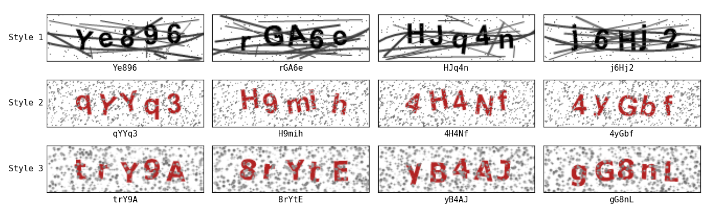

# Training and data

How the model is trained, what data it uses, and how to run another round. For shipping a model to the extension see [DEVELOPMENT.md](DEVELOPMENT.md); for what each version changed see [CHANGELOG.md](CHANGELOG.md).

- [Captcha styles](#captcha-styles)
- [Current models](#current-models)
- [Data](#data)
- [Scripts](#scripts)
- [Next round (6)](#next-round-6)
- [Review loop](#review-loop)
- [New captcha style](#new-captcha-style)
- [Rules that keep scores meaningful](#rules-that-keep-scores-meaningful)
- [Gotchas](#gotchas)

Setup: `pip install -r requirements.txt` (torch, numpy, Pillow, jupyter, matplotlib, tqdm), then `cd notebooks && jupyter lab`. Notebooks use paths relative to `notebooks/` and run on `mps` (Apple Silicon) or CPU. Apple Vision labelling (`tools/ocr`, `scripts/label_vision.py`) is macOS only.

## Captcha styles

All captchas are 150x45 PNGs with 5 characters from the same 37-character alphabet.

1. Black letters crossed by gray lines: v1, frozen in `archive/v1_2026-10-30/`.
2. Red letters on fine gray speckle (2026-10-30): v2/v3, frozen in `archive/v2_2026-10-31/` (best gold 98.5%).
3. **Current** (since 2026-10-31, between 03:02 and 08:04 UTC): the same red letters in a **bolder font** with gray blobs drawn over them. Letters-only cleaning leaves holes where a blob covers a letter, so since 2026-10-31 the model reads **three levels** (`prep.clean`: letters 0, blobs 128, paper 255; +1.5 points on gold in a controlled test). The new **J** has no top bar: every old model reads it as **3**. Other weak pairs: B/8, y/Y, g/9, a/e.

## Current models

100k style-3 captchas, 200 gold checked (2 labels fixed after a recheck). *Site* = the 8 style-3 captchas the site rejected from 5.1 (`data/site_mistakes/`). *Disputed* = the 20 test captchas where v4 and v4_ft disagree, truth read by eye (the best check of real accuracy beyond gold).

| Model (`models/`) | Trained on | Gold | Site | Disputed |
|---|---|---|---|---|
| `captcha_cnn_v4_ft.pt` | v4 fine-tuned on the 88 hard cases in `data/reviews.json` (labelled by Claude from the image, spot-checked); teacher of round 5 | 100% | 8/8 | 15/20 (reads some 8 as B, 9 as g) |
| `captcha_cnn_v5.pt` | round 5: v4_ft's labels where it agrees with Vision or its weakest character is >= 0.7 (96,806) + the 88 reviews = 96,894, three-level, from scratch | **100%** | **8/8** | **19/20** (one 8 read as B). **Ships in extensions 5.3, 5.4 and 5.5** |

The gold and site numbers for v5 were re-checked on 2026-11-18 with `python3 tools/check_extension.py` (JS equals PyTorch on 208/208); the archived models' gold and site numbers below were re-run the same day with PyTorch. The *Disputed* column is from the project's earlier notes and was not re-run (the list of 20 is not stored in the repository).

Archived: v3 (teacher of round 4, 86.0% on style-3 gold) and v4 (extension 5.2, 97.0%, 8/8, 5/20 disputed: 6 as 5, J as 3, y as Y) with round 4 in `archive/round4_2026-11-01/`; v2_ft (extension 5.1; style-3 gold 87.5%, 0/8 site) in `archive/v2_2026-10-31/models/`; v4 two-level (94.5% on corrected gold, 6/8 site) and the input-variant experiment in `archive/three_level_switch_2026-10-31/`.

## Data

Each captcha style's images live in one zip. Code reads it directly via `prep.captcha_ids()` / `prep.open_captcha(id)`; nothing needs unzipping. Ids are the numeric file names, so **ids repeat across styles**: labels, gold and reviews belong to their zip and never move between workspaces.

| File | What |
|---|---|
| `data/captchas.zip` | **The captchas of the current style** (`<id>.png`, stored uncompressed). Git-ignored and not regenerable: back it up. Style 3: 100,000 captchas (787 MB). |
| `data/gold.csv` | 200 hand-checked test captchas (`label`, pre-label `model`, `vision`, `checked` time). Never trained on. |
| `data/reviews.json` | Typed answers: the only human labels besides gold. Style 3: 88 hard cases, labelled by Claude from the image and spot-checked (`labeled_by`). Shared by all rounds of one style. |
| `data/site_mistakes/` | Style-3 captchas the live site rejected (saved by the extension), with `labels.csv` (truth read from the image, not hand-checked). Scored, not trained on. |
| `data/labels_vision.csv` | Apple Vision's read of every captcha (`vision` = valid 5-character read or `""`; `raw`). |
| `data/labels_v5.csv` | Training labels written by round 5's relabel cell: 57,437 `agree`, 39,369 `confident`, 88 `review` (used for training) and 2,906 `disagree` (not used). |
| `cache/` | Decoded-image cache (`clean_images.npz`) and logs. Git-ignored, rebuilt automatically. |

Make the zip from a downloaded folder, stored uncompressed: `zip -0 -q -r data/captchas.zip "<folder>"` (any folder name inside works; add more later with `zip -0 -q -r -u`). Verify, then delete the loose PNGs.

Older styles: `archive/v2_2026-10-31/data/captchas.zip` (style 2, 100,000 captchas, 376 MB) and `archive/v1_2026-10-30/training/data/varun.zip` (style 1, 126,919 captchas, 545 MB; archived v1 code expects a `varun/` folder, so `unzip -q varun.zip` first). All zips are git-ignored. Keep them backed up: every label and model refers to these images by id.

## Scripts

| Script | What |
|---|---|
| `scripts/prep.py` | Shared by notebooks and scripts. Reads captchas from the zip (`<id>.png`, any folder inside), `clean()` makes the three-level image the CNN reads, `ink()` letters only (Vision and two-level models), plus the Apple Vision helpers. |
| `scripts/label_vision.py` | Terminal, from the project root: Apple Vision reads every captcha into `data/labels_vision.csv` (about 8 minutes, resumable). |
| `scripts/audit_gold.py` | Builds and pre-labels the gold set (first run), then lets you check it (Enter or type a correction). |
| `scripts/relabel.py` | The notebook's `TEACHER` reads every non-gold captcha into a labels CSV with a source per row (`agree`, `vision_fix`, `confident`, `disagree`, `review`), the model read, its confidence and Vision's read. Knobs set in the notebook: `VISION_FIXES` (character pairs where Vision's read wins; round 4: 3 to J) and `MIN_CONF` (trust the teacher's reads this confident; round 5: 0.7). |
| `scripts/review.py` | Type-in review, 50 per run: model-versus-Vision disagreements first, then least confident. `FOCUS` filters by characters. |
| `scripts/finetune.py` | Fine-tunes `MODEL_PATH` on all reviews plus 5,000 anchors into `FT_PATH`. Always restarts from the baseline, so re-running never stacks fine-tunes. |
| `notebooks/train_v5.ipynb` | Round 5 (run, shipped in 5.3): relabel with v4_ft (agree with Vision, or confidence >= 0.7), plus reviews, three-level, from scratch. Template for later rounds (round 4 and the style-2 rounds are in the archive). |
| `tools/run_round.py` | Runs a round notebook headless up to the review loop (sections 1–11) and saves its outputs; needs gold already checked. |
| `tools/check_extension.py` | The pre-ship check, see [DEVELOPMENT.md](DEVELOPMENT.md#run-the-checks). |

## Next round (6)

v5 already scores 100% on gold, so gold can no longer tell a better model apart. Wait for real misses first: when 5.3 and later save rejected captchas, label them and use them as the score that matters.

1. Move `~/Downloads/captcha_mistakes/*.png` into `data/site_mistakes/` and add a row per file to its `labels.csv` (`truth` = what the image says). They are scored, not trained on. Optionally add some to `data/reviews.json` (review loop below) so they are trained on next time.
2. Copy `notebooks/train_v5.ipynb` to `train_v6.ipynb`. In its setup cell set `TEACHER = "../models/captcha_cnn_v5.pt"` and `LABELS_CSV`, `MODEL_PATH`, `FT_PATH` to `v6`, plus the relabel knobs `VISION_FIXES` / `MIN_CONF` (see `scripts/relabel.py`). Update the intro and the section-10 names.
3. `python3 tools/run_round.py notebooks/train_v6.ipynb` from the project root (about 12 minutes, no input): relabel into `data/labels_v6.csv`, train into `models/captcha_cnn_v6.pt`, and section 10 prints gold for teacher versus new.
4. `python3 tools/check_extension.py models/captcha_cnn_v6.pt`, and the same with no argument (the shipped v5): compare gold and site scores. Every JS read must match PyTorch.
5. If v6 beats v5: ship it ([DEVELOPMENT.md](DEVELOPMENT.md#ship-a-model-to-the-extension)), update the table above, archive the previous round like `archive/round4_2026-11-01/` (its notebook, labels and models; keep the new round's teacher) and commit.

## Review loop

Optional, any round. Open the round notebook, run sections 1–3 and 6–8, then 12 (review 50), 13 (fine-tune) and 14 (what changed on gold). Repeat while gold improves. `FOCUS` in `scripts/review.py` picks characters (remaining weak pair: 8 read as B). Labelling hard cases from the image outside the notebook (as for the 88 style-3 reviews) works too: add entries to `data/reviews.json` in the same format.

## New captcha style

Archive the workspace like `archive/v2_2026-10-31/` (data, round notebooks, cache; ids will clash with the new set), put the PNGs in `data/captchas.zip`, check that `prep.clean` still separates letters, blobs and paper (section 7 preview), run `scripts/label_vision.py`, and copy the latest round notebook with the best model as `TEACHER` (it builds a new gold set in section 4). Check where the teacher and Vision disagree (relabel prints the character pairs) before trusting either.

## Rules that keep scores meaningful

- **Gold is never trained on, relabelled or reviewed.** Every script skips `GOLD` ids. Compare models on gold only; val/test only measure agreement with the teacher's labels.
- **Preprocessing must match**: `scripts/prep.py` `clean()` and `extension/model.js` `clean()` both make pixels with `r - g > 60 && r - b > 60` letters (0), other pixels with `r + g + b < 600` blobs (128), everything else 255. Change both or neither, then re-export. Checkpoints say which cleaning they need (`levels`: 3, or missing = 2 = letters only: v1-v3 and the archived v4 two-level). The notebook's `load_model` and the exported `model.json` carry it, so old and new models both read correctly.
- **Alphabet** (`2345689ABDEFGHJLMNQRTYabdefghijmnqrty`, no 0/O/1/l/I/7) comes from the checkpoint. Gold checking accepts any letter or digit and warns if a new character appears. Adding one means new head classes and removing the matching entries from `prep.LEARNED`.
- `export_model.py` only knows this architecture (4 blocks of conv-BN-ReLU x2 + maxpool, widths 32/64/128/192, mean over height, Linear 512, 5 heads). A different network needs export and `model.js` changes too.

## Gotchas

- Editing a `.ipynb` on disk while it is open in Jupyter: use File > Reload Notebook from Disk (choose Revert, not Overwrite, if asked). The kernel keeps its state.
- `scripts/label_vision.py` uses all CPU cores via multiprocessing: run it from a terminal, not a notebook cell. It skips ids already in `data/labels_vision.csv`, so a new captcha set needs a fresh file.
- The notebook loads `VISION` once in section 2; `relabel.py` re-reads the file itself.
- The Safari port (`archive/v1_2026-10-30/safari/`) is still v4.1 for the old captchas and was not updated.
- `archive/v1_2026-10-30/training/v2/cache/all_images.npz` (820 MB) and `archive/v2_2026-10-31/cache/` (670 MB) are regenerable caches; delete them if space matters.
